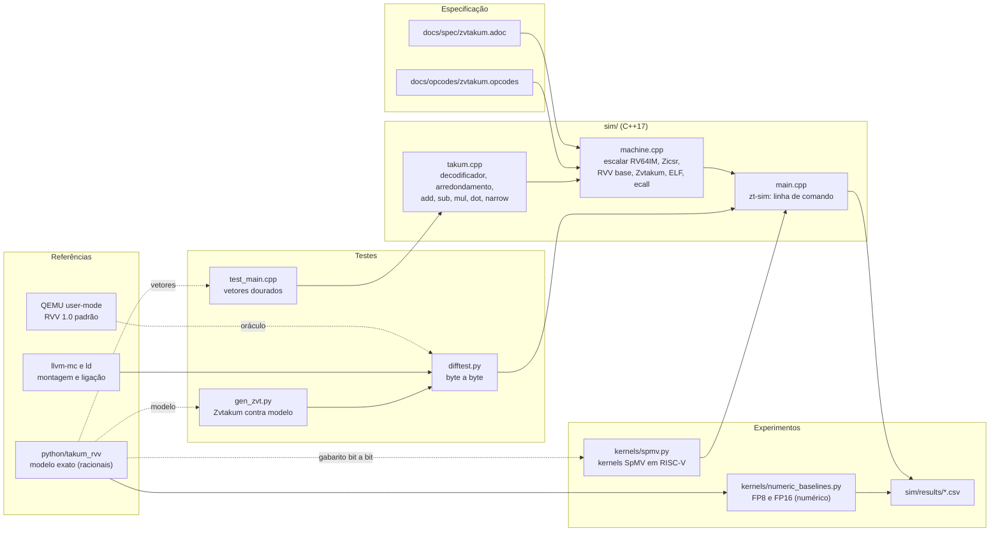

# Arquitetura: simulador Takum-RVV (branch refactor/zvtakum-cpp)

Este documento descreve o que foi implementado nesta branch, como as partes se conectam e
como cada uma é verificada. As decisões de projeto e suas alternativas estão em
`docs/decisoes.md`. A especificação das instruções está em `docs/spec/zvtakum.adoc`.

## Escopo

O processador modelado é um núcleo RISC-V de 64 bits com:

| Bloco | Conteúdo | Estado |
|---|---|---|
| Escalar | RV64IM (incluindo MUL e DIV) e Zicsr | implementado e testado contra QEMU |
| Vetorial base | `vsetvl*`, `vle8/16/32`, `vse8/16/32`, `vluxei32`, `vmv.v.i/v.v`, `vfadd.vv`, `vfmul.vv`, `vfredusum.vs` | implementado e testado contra QEMU |
| Zvtakum (custom-0) | `vtadd`, `vtsub`, `vtmul`, `vtdot`, `vncvt.t.t`, para T8, T16 e T32 | implementado; testado contra o modelo Python |
| Zvfh (FP16) | reconhecido pelo assembler | não executado pelo simulador |
| Variante logarítmica | — | fora do escopo desta branch |
| FP8 | — | não existe na RVV; apenas referência numérica (Python) |

Não são modelados: modo privilegiado, MMU, instruções comprimidas (C), cache, pipeline e
ciclos. As contagens são de instruções e de eventos, não de tempo.

## Componentes



### `sim/src/takum.cpp`: datapath Takum

Aritmética em inteiros de 128 bits, sem `double`:

* **Decodificação:** lê a janela de 12 bits (zeros fantasmas quando n < 12), obtém S, D, R e C, e extrai a fração com deslocamento de largura variável. O resultado é um valor exato `(-1)^neg · sig · 2^(e-63)`, com `sig` normalizado.
* **Soma e subtração:** alinha o menor operando ao maior com bit *sticky*, soma ou subtrai, normaliza com a posição do bit líder e codifica.
* **Produto:** multiplica os significandos (até 28 × 28 bits em T32 e 60 × 60 em T64) e soma os expoentes.
* **Codificação:** monta a cadeia infinita do código (cabeçalho e fração), toma o prefixo de n+1 bits e arredonda pelo bit de meio-ponto e pelo sticky (RNE no código). Satura em maxpos e minpos, não produz infinito e aplica o complemento de dois para negativos.
* **vtdot (um passo):** arredonda o produto em 2n, depois a soma em 2n.
* **narrow:** decodifica exatamente e codifica no formato menor.

O `double` é a causa das 128 divergências T32 registradas pelo modelo Python contra a libtakum (caso 784 do relatório Python). Por isso o datapath não o usa.

### `sim/src/machine.cpp`: núcleo

* Busca e decodificação de instruções de 32 bits. Instruções comprimidas e ausentes são ilegais.
* Escalar: RV64IM, Zicsr, desvios, cargas e armazenamentos com extensão de sinal, `ecall` com `write` (fd 1) e `exit`, compatível com a ABI Linux usada pelo QEMU.
* Vetorial: banco de 32 registradores de VLEN bits, `vtype` com SEW, LMUL, `vta` e `vma`, `vl` e `vstart`, máscara em v0, grupos LMUL verificados, `vill` para configurações inválidas.
* Zvtakum: cinco operações no espaço custom-0, com as políticas e os grupos da especificação.
* Contadores: instruções (total, escalares, `vsetvl`, vetoriais, Zvtakum), leituras e escritas de CSR (incluindo vl e vtype escritos por `vsetvl`), elementos ativos, bytes lidos e escritos, bytes de índice.

### `sim/src/main.cpp`: linha de comando

`zt-sim PROGRAMA.elf [--vlen BITS] [--mem MIB] [--max-insns N] [--stdout ARQ] [--counters ARQ]`. Carrega ELF64 RISC-V (ET_EXEC), executa e grava a saída de `write` e os contadores em JSON.

## Processo de build e verificação

```
make -C sim                       # compila build/zt-sim
make -C sim test                  # testes do núcleo Takum (vetores dourados)
python3 sim/tests/gen_asm.py      # gera programas de RVV e escalar
python3 sim/tests/gen_zvt.py      # gera o teste Zvtakum e a saída esperada
python3 sim/tests/difftest.py     # executa tudo e compara
python3 sim/kernels/spmv.py       # SpMV em 8 matrizes, 4 formatos, 3 VLENs
python3 sim/kernels/numeric_baselines.py
```

### Níveis de verificação

| Nível | Teste | Referência | Resultado |
|---|---|---|---|
| Núcleo Takum | Tabelas T8 completas (add, sub, mul) e narrow T16→T8 | modelo Python | 0 divergências |
| Núcleo Takum | Operações amostradas em T16, T32 e T64; vtdot amostrado | modelo Python | 0 divergências |
| Núcleo Takum | Ida e volta do codificador em T8 e T16 | valor decodificado | 0 divergências |
| Escalar e RVV padrão | 6 execuções (2 programas × 3 VLENs), com QEMU em modo `ta/ma` com 1s | QEMU 10.2.2 | bytes e código de saída iguais |
| Zvtakum | 3 execuções (1 programa × 3 VLENs), com máscara, cauda, vl parcial, vl = 0, grupos LMUL, vtdot e vncvt | modelo Python | bytes iguais |
| SpMV | 96 execuções (8 matrizes × 4 formatos × 3 VLENs) | `scalar_spmv` (Python) | bit a bit iguais |
| Modelo de contagem | 12 programas sintéticos e 96 execuções reais, `N = rR + cS + K` | medição direta | resíduo 0 |

Os testes do escalar e do RVV padrão cobrem, entre outros: as combinações de `vsetvli` com
rd e rs1 iguais a x0; máscaras com `v0.t`; cauda `tu`; `vl = 0`; `vstart` escrito pelo
programa; grupos LMUL=2; gather indexado com índices de 32 bits. Os tamanhos de saída
mudam com o VLEN, o que confirma que os registradores vetoriais estão de fato em uso.

## Kernel SpMV

Um mesmo laço escalar percorre as linhas do CSR. Cada faixa usa:

* **FP32:** `vle32` de valores, `vle32` de offsets em bytes, `vluxei32` para x, `vfmul.vv` e `vfredusum.vs` com o acumulador em `vd[0]`.
* **Takum n:** `vsetvli` com índices em EMUL = 32/n (para n = 8 e 16, o índice é carregado com `e32` e LMUL maior), `vle` de valores, `vluxei32` para x, `vtdot.vv` com acumulador 2n, e no fim de cada linha `vncvt.t.t` e `vse`.

Os offsets de x são pré-multiplicados pelo tamanho do elemento. Essa preparação é feita no host e não é
contada, de forma idêntica para formatos do mesmo tamanho. Todo o resto (laços, endereços, `vsetvli`
e a zeragem do acumulador de 2n bits por linha) executa no simulador.

O número de instruções segue `N = rR + cS + K`, com os parâmetros medidos por
`sim/kernels/modelo_contagem.py`:

| Formato | r (por linha) | c (por faixa) | K |
|---|---|---|---|
| FP32 | 13 | 12 | 21 |
| Takum32 | 14 | 11 | 21 |
| Takum8 | 14 | 12 | 21 |
| Takum16 | 14 | 13 | 21 |

Em relação ao FP32, o `vncvt.t.t` de fechamento custa uma instrução por linha, e o `vtdot` substitui
`vfmul` e `vfredusum`, economizando uma por faixa. Logo `N_Takum32 − N_FP32 = R − S`. Os kernels de 8 e 16 bits
gastam um `vsetvli` extra por faixa (o índice de 32 bits usa LMUL maior), e o de 16 bits um deslocamento extra
para os valores de 2 bytes.

## Limites conhecidos

* Os programas de teste não cobrem todo o espaço de instruções. A conformidade é por amostra e por casos de borda, não por prova.
* O simulador não tem cache, pipeline nem tempo. Os contadores medem o que o programa faz, não quanto tempo leva.
* As matrizes SpMV são as oito Harwell-Boeing de `python/data/harwell_boeing` (n ≤ 1033). O estudo de 1401 matrizes (MuFoLAB) não foi executado nesta branch.
* A variante logarítmica não existe no simulador nem no modelo Python desta branch.
* FP16 (Zvfh) e FP8 aparecem apenas como referência numérica, sem contagem de instruções.
